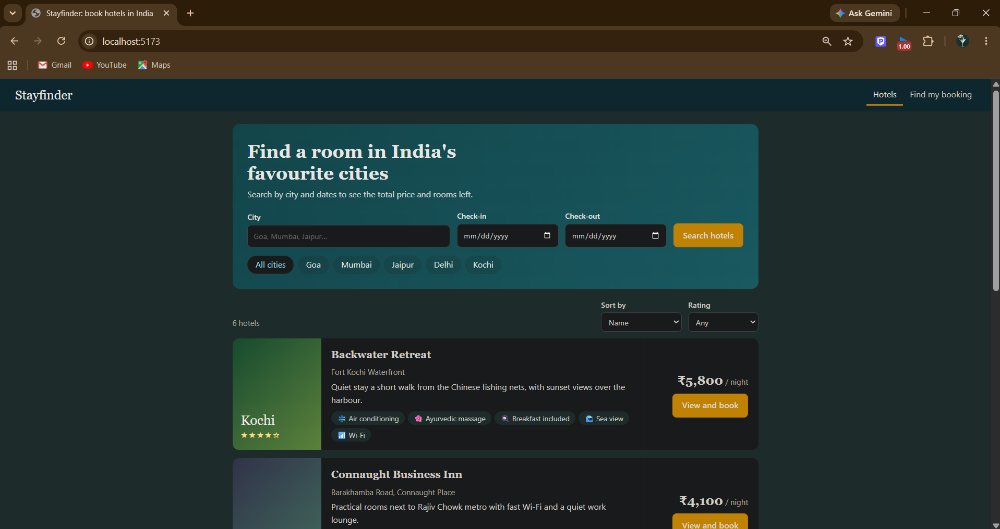
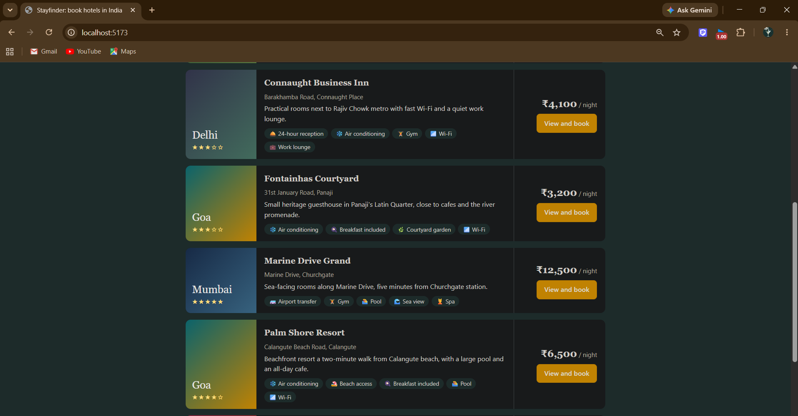
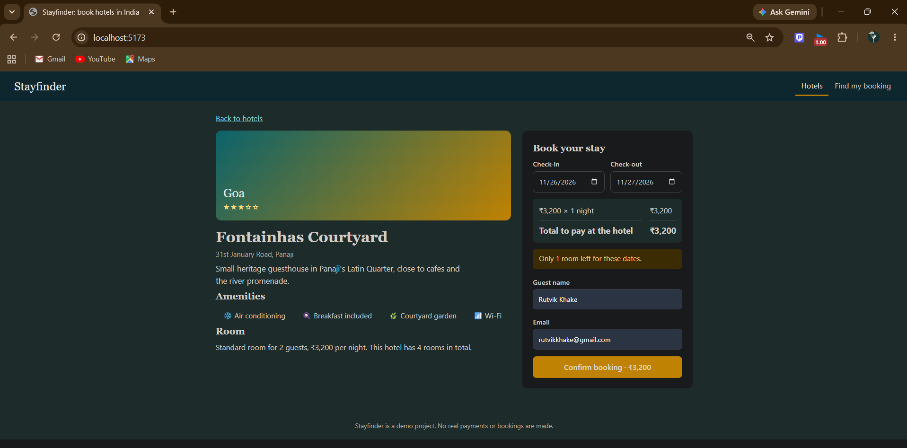
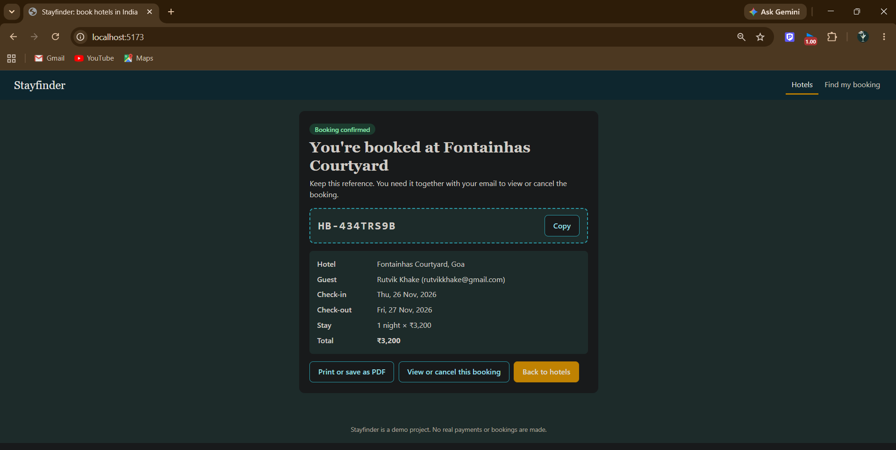
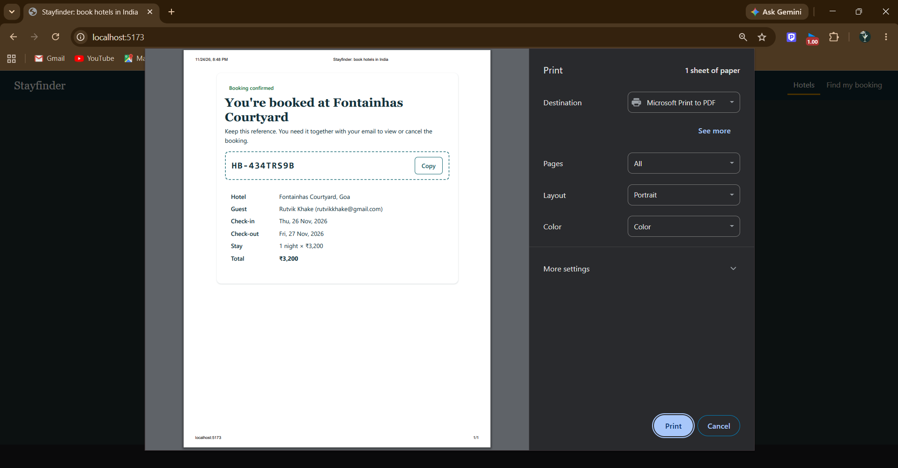
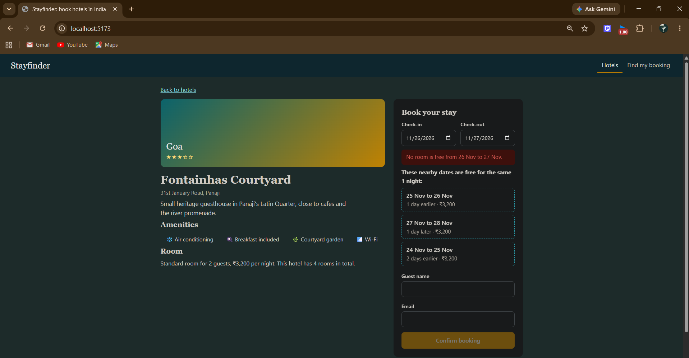
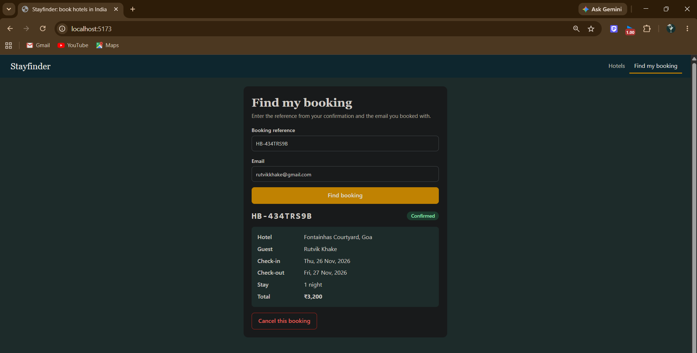
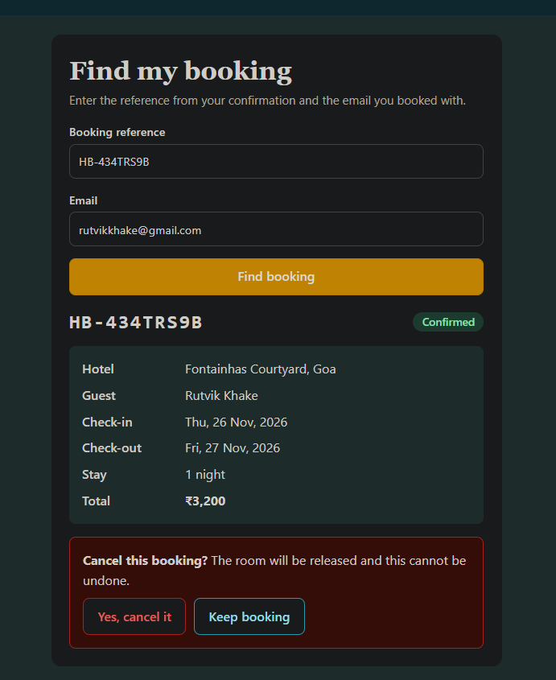
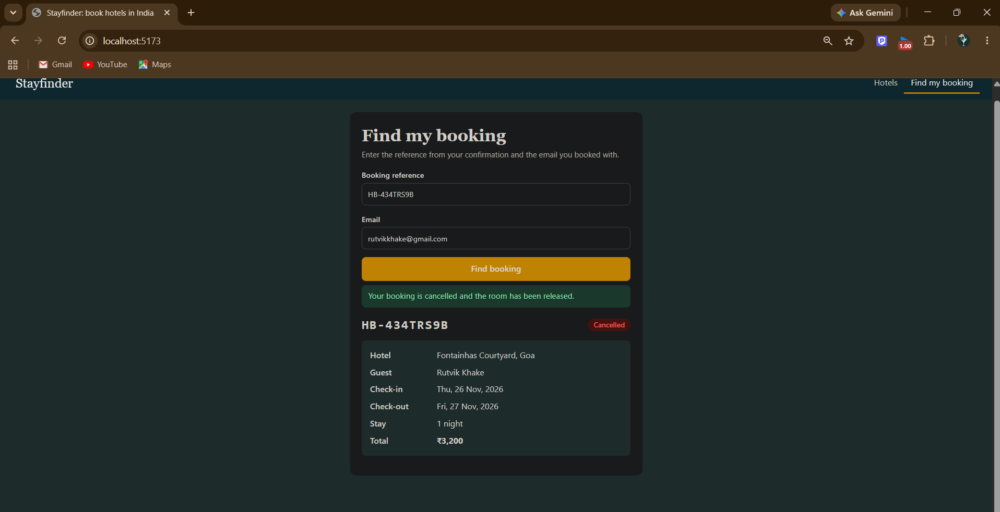

# Stayfinder – Hotel Booking Portal

Stayfinder is a hotel booking website developed as part of my full-stack development interview assignment. It allows users to search for hotels, check room availability, make bookings and manage their reservations.

## Technology Used

| Layer | Technology |
|---|---|
| Backend | Java 17, Spring Boot 3.3 |
| Database | MySQL 8 |
| Frontend | React 18, Vite |
| ORM | Spring Data JPA |
| Testing | JUnit 5, Mockito |

**Note:** The assignment specified Angular for the frontend. I used React with Vite because I am more familiar with React. The backend exposes REST APIs that can also be used by an Angular frontend.

For more details about the design and implementation, see [DESIGN.md](DESIGN.md).

## Features

- Displays six sample hotels with their location, description, amenities, ratings and prices.
- Allows users to search hotels by city.
- Provides check-in and check-out date selection.
- Shows room availability and the total price for the selected stay.
- Allows users to sort hotels by price or rating and filter by rating.
- Displays hotel details, facilities and price breakdown.
- Allows users to book a room using their name and email address.
- Generates a unique booking reference after a successful booking.
- Allows users to retrieve a booking using the booking reference and email.
- Supports booking cancellation and makes the cancelled room available again.
- Displays validation messages when entered details are incorrect.

### Surprise Feature – Nearby Free Dates

Sometimes a hotel may not have rooms available for the dates selected by the user. In that situation, Stayfinder checks nearby dates within the next 14 days and suggests alternative dates with the same number of nights.

The user can select one of the suggested dates instead of searching again manually.

## Requirements

Make sure the following software is installed:

- Java 17 or later
- Maven 3.8 or later
- Node.js 20 or later
- MySQL 8

You can check the installed versions using:

```bash
java -version
mvn -v
node -v
```

## Running the Project

### 1. Database Setup

The application uses MySQL with a database named `hotel_portal`.

The backend is configured to create the database if it does not exist and execute the SQL scripts.

The database scripts are located at:

```text
backend/src/main/resources/
    schema.sql
    data.sql
```

- `schema.sql` creates the required tables.
- `data.sql` inserts the six sample hotels and their amenities.

If you want to create the database manually, use:

```sql
CREATE DATABASE IF NOT EXISTS hotel_portal;
```

### 2. Start the Backend

Open a terminal in VS Code and run:

```powershell
cd backend
$env:DB_PASSWORD = 'your-mysql-password'
mvn spring-boot:run
```

Replace `your-mysql-password` with your actual MySQL password.

Wait until Spring Boot starts successfully.

To check the hotel API, open:

http://localhost:8080/api/hotels

It should return the hotel data in JSON format.

### 3. Start the Frontend

Open another terminal in VS Code and run:

```bash
cd frontend
npm install
npm start
```

After the development server starts, open:

http://localhost:5173

The frontend communicates with the backend through the `/api` endpoints.

### 4. Run Backend Tests

Open a terminal and run:

```bash
cd backend
mvn test
```

The backend contains 19 unit tests using JUnit 5 and Mockito. These cover important parts of the application, including price calculation, date validation, room availability, booking cancellation and nearby free dates.

## How to Use the Application

1. Open the website.
2. Search for a city, such as Goa.
3. Select the check-in and check-out dates.
4. Browse the available hotels.
5. Open a hotel to see its details and price breakdown.
6. Enter your name and email address to book a room.
7. Note the booking reference shown after confirmation.
8. Open the booking lookup section and enter the reference and email address.
9. View your booking details or cancel the reservation.

To try the nearby free dates feature, select dates when a hotel has no rooms available. The application will display alternative dates if available.

## API Endpoints

| Method | Endpoint | Description |
|---|---|---|
| GET | `/api/hotels` | Get hotels and search results |
| GET | `/api/hotels/{id}` | Get hotel details |
| GET | `/api/hotels/{id}/alternatives` | Find nearby available dates |
| POST | `/api/bookings` | Create a booking |
| GET | `/api/bookings/{reference}` | Retrieve a booking |
| POST | `/api/bookings/{reference}/cancel` | Cancel a booking |

## Project Structure

```text
hotel-booking-portal/
│
├── backend/
│   ├── src/
│   │   ├── main/
│   │   │   ├── java/com/example/hotel/
│   │   │   │   ├── controller/
│   │   │   │   ├── service/
│   │   │   │   ├── repository/
│   │   │   │   ├── model/
│   │   │   │   ├── dto/
│   │   │   │   └── exception/
│   │   │   └── resources/
│   │   └── test/
│   └── pom.xml
│
├── frontend/
│   ├── src/
│   │   ├── pages/
│   │   ├── api.js
│   │   ├── App.jsx
│   │   └── styles.css
│   └── package.json
│
├── docs/
│   └── screenshots/
│
├── DESIGN.md
└── README.md
```

## Assumptions

- Each hotel has one room category, and each booking is for one room.
- Check-in and check-out dates are selected by the user.
- A room is occupied from the check-in date up to, but not including, the check-out date.
- Back-to-back bookings are allowed when one guest checks out on the same date another guest checks in.
- The maximum stay is 30 nights.
- Check-in cannot be in the past.
- A booking can be cancelled before its check-in date.
- Prices are displayed in Indian rupees.
- Online payment and user login are not included in this version.

## Limitations

- The frontend is built using React instead of Angular.
- Automated frontend and end-to-end tests are not included.
- Booking confirmation emails are not implemented.
- User authentication is not included.
- Payment processing is outside the scope of this assignment.

## Notes for Reviewers

**Time spent:** Approximately [enter your actual development time].

**AI assistance:** I used ChatGPT and GitHub Copilot during development for guidance, debugging, understanding code and preparing documentation. I tested the application and checked the main booking operations. I am also preparing to explain the implementation and technical decisions during the interview.

**Frontend choice:** React was used instead of Angular because I am more familiar with React. I understand that this differs from the requested technology stack.

## Screenshots

The screenshots of the application are stored in `docs/screenshots/`.

The following screenshots demonstrate the main features:


### 1. Homepage


### 2. Hotel Listing


### 3. Booking


### 4. Booking Confirmation


### 5. Print Booking


### 6. Nearby Free Dates


### 7. Find Booking


### 8. Cancelling Booking


### 9. Cancellation Confirmation
